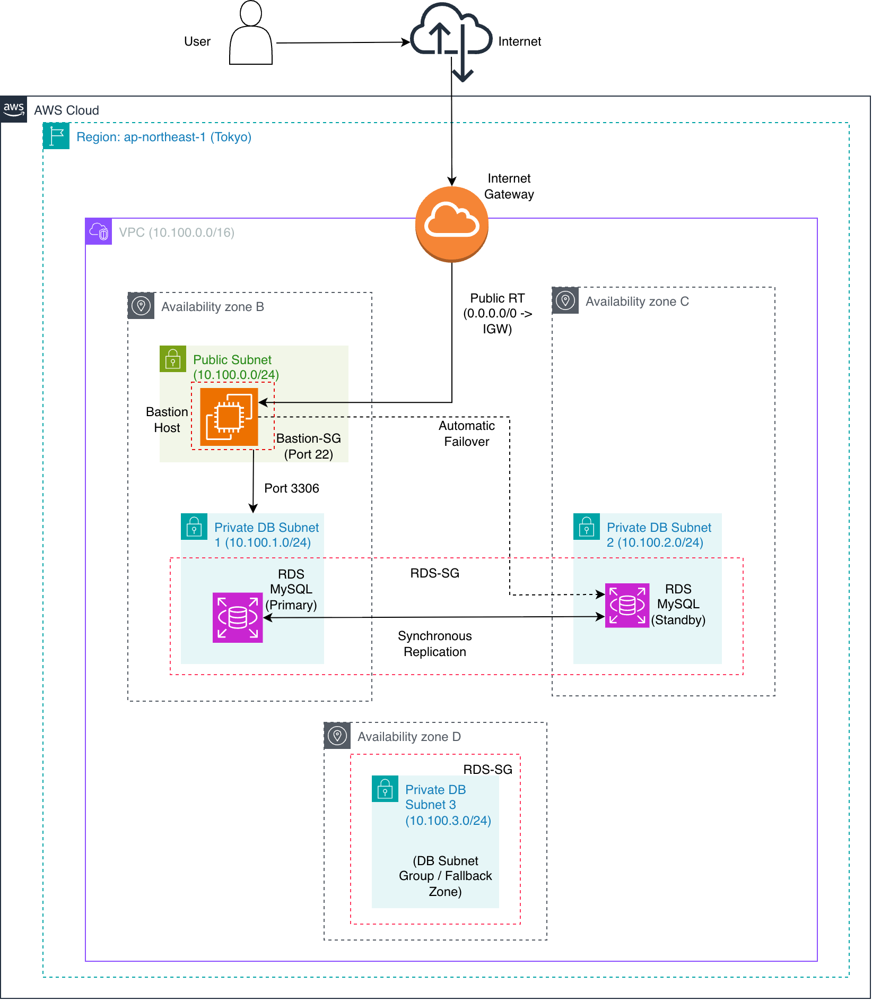
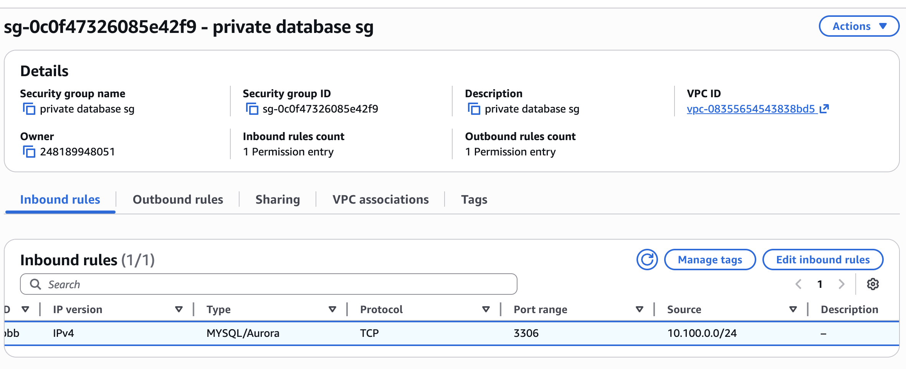
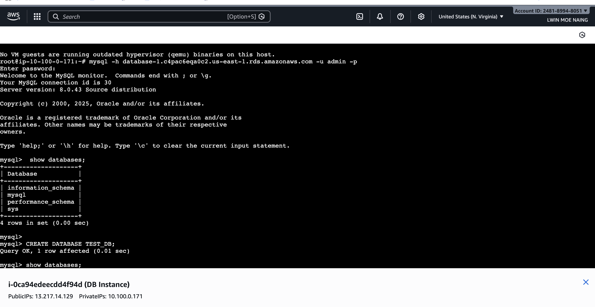
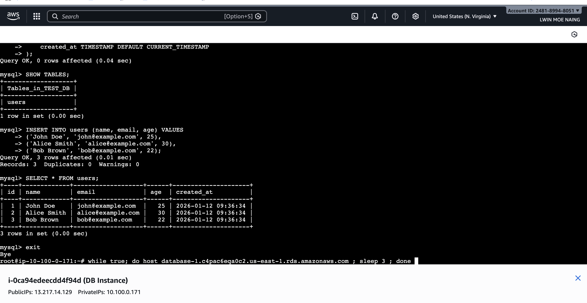
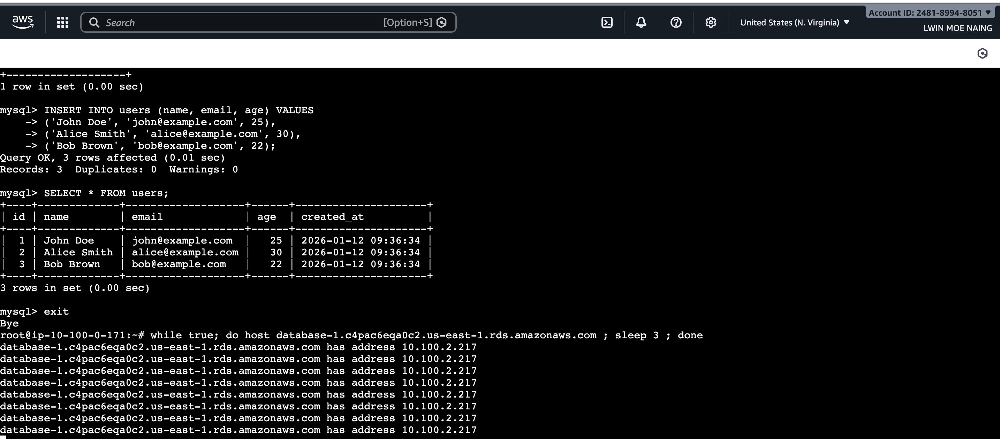
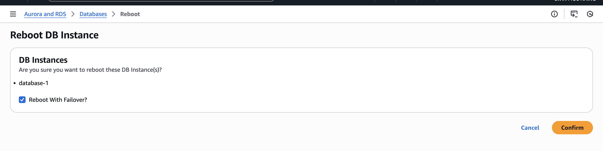
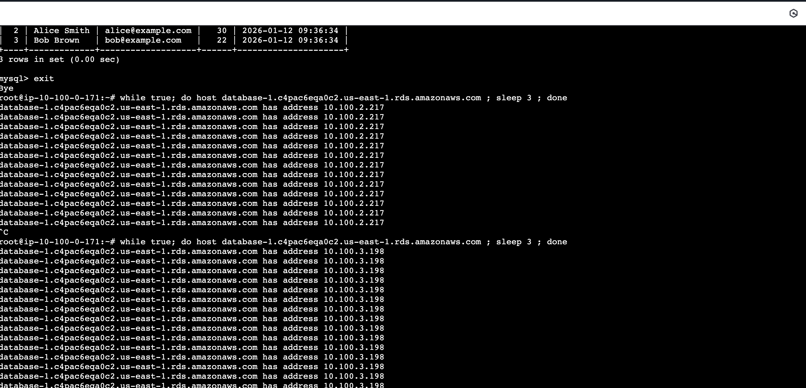
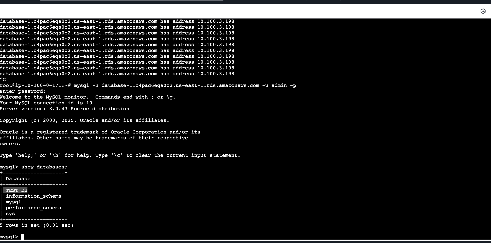
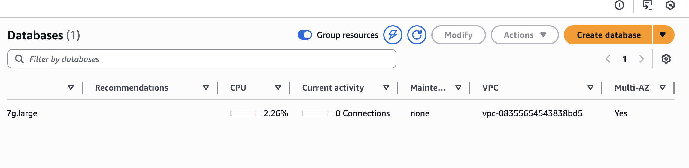

[日本語版 (Japanese Version)](./README_ja.md)

# AWS RDS Multi-AZ Deployment & Failover Lab

**AWS RDS Multi-AZ Deployment and Automatic Failover Testing Project with EC2 Bastion Host.**

**Scenario:** To ensure high availability and prevent data loss for business-critical applications, I implemented an AWS RDS Multi-AZ deployment. This project demonstrates the setup of a resilient database architecture and verifies the automatic failover process during a simulated disaster recovery scenario.

---

# **Project Architecture**

This setup utilizes a Public/Private Subnet architecture within a custom VPC to ensure maximum security for the database layer.

#  **Key Components**

* **VPC:** A secure, isolated network created with CIDR `10.100.0.0/16`.
* **Public Subnet:** Used for the Ubuntu EC2 Instance (Bastion Host) at `10.100.0.0/24`.
* **Private DB Subnets:** Three subnets distributed across Zones B, C, and D for Multi-AZ redundancy (`10.100.1.0/24`, `10.100.2.0/24`, `10.100.3.0/24`).
* **RDS Multi-AZ Deployment:** Synchronous replication between a Primary Instance and a Standby Instance in different AZs.

---

#  **Implementation Steps**

| Step | Description | Screenshot |
|:---:|---|:---:|
| **1. Security Group** | Configured inbound rules for Port 3306 restricted to the Public Subnet. |  |
| **2. DB Connection & Creation** | Established connection to the RDS endpoint and successfully created the `TEST_DB` database. |  |
| **3. Data Entry** | Created the `users` table and inserted sample data records. |  |
| **4. Pre-Failover** | Verified the current active IP address (`10.100.2.217`) before triggering failover. |  |
| **5. Trigger Failover** | Executed "Reboot with Failover" via the AWS RDS Console. |  |
| **6. Post-Failover** | Verified the new active IP address (`10.100.3.198`) after successful failover. | |
| **7. Data Integrity** | Confirmed that `TEST_DB` and all records remained intact after the switch. |  |
| **8. Multi-AZ Status** | Confirmed the "Multi-AZ: Yes" status on the RDS Dashboard to ensure infrastructure redundancy. |  |

---

#  **Technical Insights**

- **High Availability (HA):** By using AWS RDS Multi-AZ, the service can recover in seconds from an AZ failure, ensuring minimal downtime for users.

 

- **Zero Data Loss:** Synchronous replication guarantees that the standby instance is always up-to-date, preventing data loss during failover.

 

- **Seamless Failover via RDS Endpoint:** The Bastion Host connects via a single RDS DNS Endpoint. During a failover, AWS automatically updates the DNS record to point to the Standby instance's IP, requiring no manual application-level changes.

 

- **Resilient DB Subnet Group:** By configuring a DB Subnet Group across three Availability Zones (Zones B, C, and D), the architecture ensures that if one zone fails entirely, AWS can provision a new standby instance in the fallback zone (Zone B) to maintain the Multi-AZ standard.

 

- **Security Best Practice:** Placing the database in a private subnet and using a Bastion Host protects the data from direct external attacks.
---

#  **Tech Stack**

* **AWS Services:** RDS (MySQL), EC2 (Ubuntu 24.04), VPC, Security Groups
* **Database Tools:** MySQL Client 8.0
* **Protocols:** TCP/IP, Port 3306(MySQL),Port22 (SSH)
