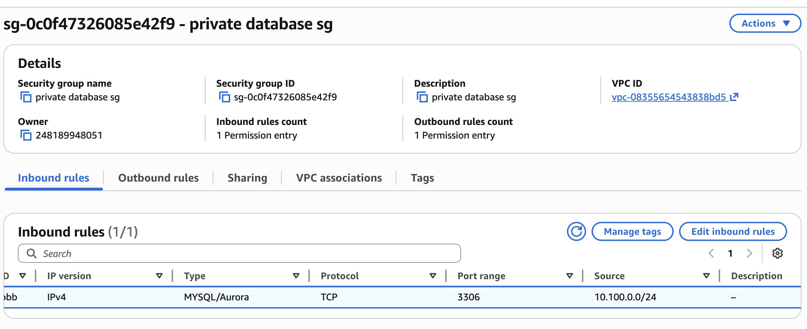
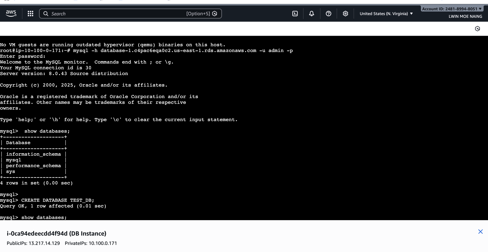
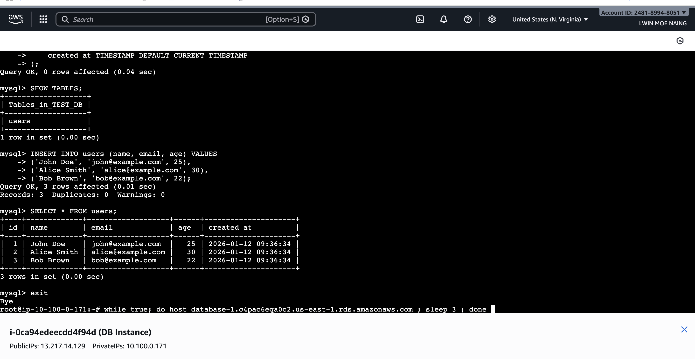
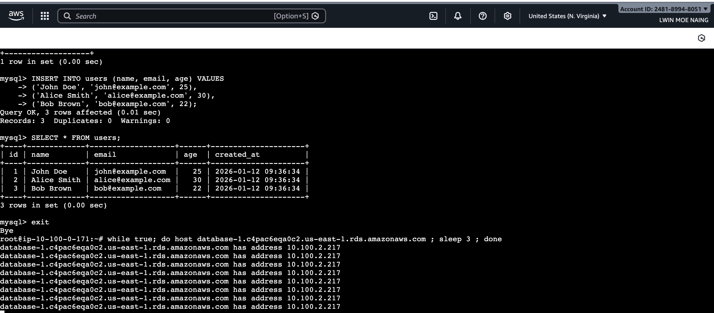
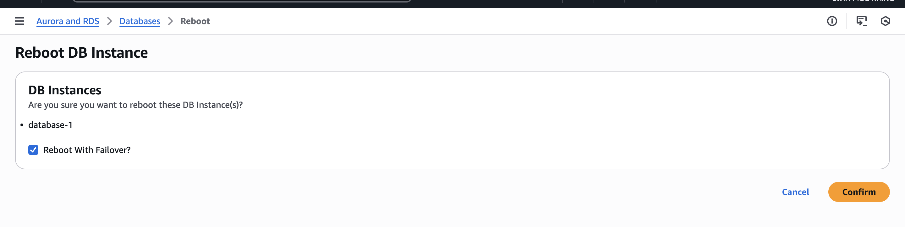
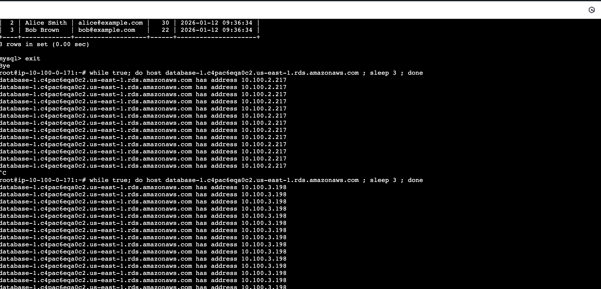
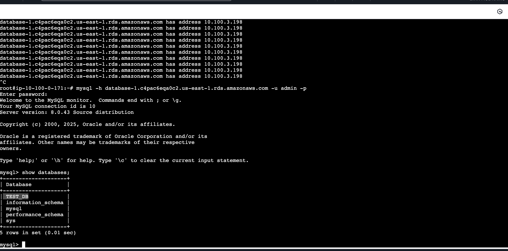
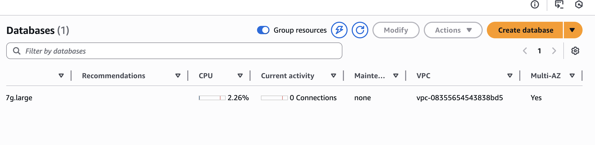

[English Version](./README.md)

# AWS RDS マルチAZデプロイメント ＆ フェイルオーバーラボ

**EC2踏み台サーバー（Bastion Host）を使用したAWS RDSマルチAZデプロイメントおよび自動フェイルオーバーテストプロジェクト。**

**シナリオ:** ビジネスに不可欠なアプリケーションのデータ損失を防ぎ、高可用性を確保するために、AWS RDSマルチAZデプロイメントを実装しました。このプロジェクトでは、復旧能力の高いデータベースアーキテクチャの構築と、災害復旧シナリオを想定した自動フェイルオーバープロセスの検証を行っています。

---

# **プロジェクト構成図**

このセットアップでは、データベース層のセキュリティを最大限に確保するために、カスタムVPC内のパブリック/プライベートサブネットアーキテクチャを利用しています。

#  **主な構成要素**

* **VPC:** CIDR `10.100.0.0/16` で作成された安全で隔離されたネットワーク。
* **パブリックサブネット:** `10.100.0.0/24` に配置された Ubuntu EC2 インスタンス（踏み台サーバー）用。
* **プライベートDBサブネット:** マルチAZの冗長性を確保するため、ゾーンB、C、Dに分散された3つのサブネット（`10.100.1.0/24`、`10.100.2.0/24`、`10.100.3.0/24`）。
* **RDSマルチAZデプロイメント:** 異なるAZに配置されたプライマリインスタンスとスタンバイインスタンス間の同期レプリケーション。

---

#  **実装手順**

<b>ステップごとの設定と結果を表示するにはここをクリック</b>

| ステップ | 説明 | スクリーンショット |
|:---:|---|:---:|
| **1. Security Group** | パブリックサブネットからのポート3306のみを許可するようにインバウンドルールを構成しました。 |  |
| **2. DB Connection & Creation** | RDSエンドポイントへの接続を確立し、`TEST_DB`データベースを正常に作成しました。 |  |
| **3. Data Entry** | `users`テーブルを作成し、サンプルデータレコードを挿入しました。 |  |
| **4. Pre-Failover** | フェイルオーバーを実行する前に、現在アクティブなIPアドレス（`10.100.2.217`）を確認しました。 |  |
| **5. Trigger Failover** | AWS RDSコンソールから「フェイルオーバーを伴う再起動」を実行しました。 |  |
| **6. Post-Failover** | フェイルオーバー成功後、新しいアクティブIPアドレス（`10.100.3.198`）を確認しました。 | |
| **7. Data Integrity** | 切り替え後も`TEST_DB`とすべてのレコードがそのまま残っていることを確認しました。 |  |
| **8. Multi-AZ Status** | インフラストラクチャの冗長性を確保するために、RDSダッシュボードで「マルチAZ：はい」のステータスを確認しました。 |  |

---

#  **技術解説**

* **マルチAZによる高可用性:** AWS RDSマルチAZを使用することで、AZ障害から数秒で復旧でき、ユーザーのダウンタイムを最小限に抑えることができます。

 

* **データ損失ゼロ:** 同期レプリケーションにより、スタンバイインスタンスが常に最新の状態に保たれ、フェイルオーバー時のデータ損失を防ぎます。

 

* **セキュリティのベストプラクティス:** データベースをプライベートサブネットに配置し、踏み台サーバーを使用することで、外部からの直接的な攻撃からデータを保護します。

---

#  **使用技術**

* **AWSサービス:** RDS (MySQL), EC2 (Ubuntu 24.04), VPC, セキュリティグループ, Route 53
* **データベースツール:** MySQL クライアント 8.0
* **プロトコル:** TCP/IP, ポート 3306
